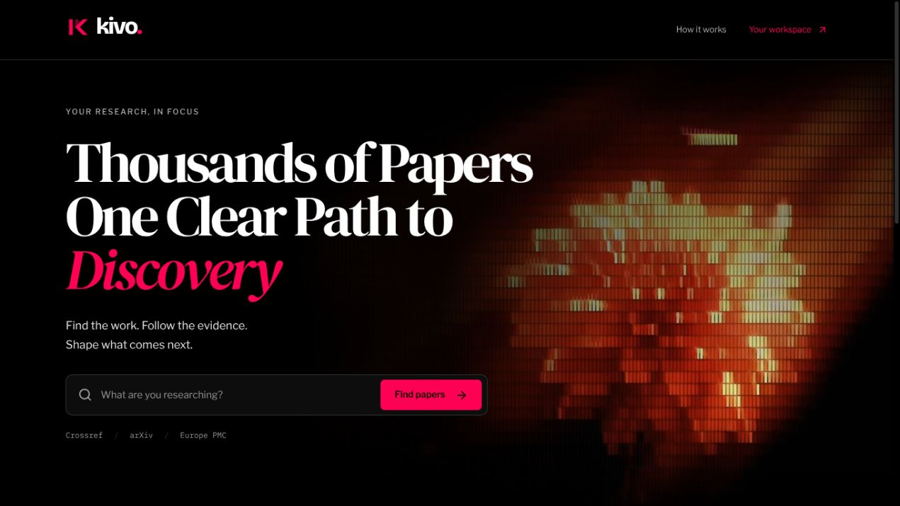
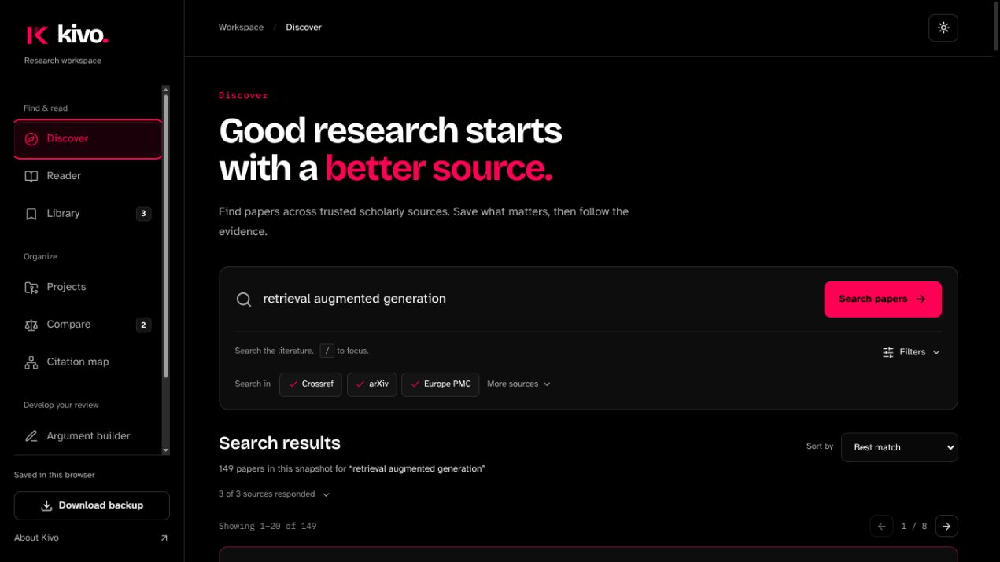
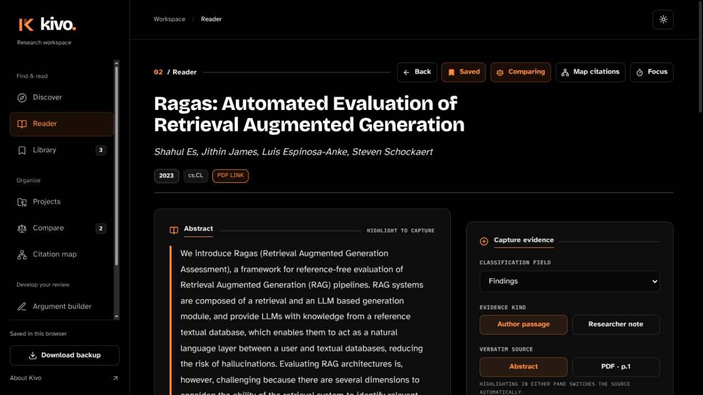
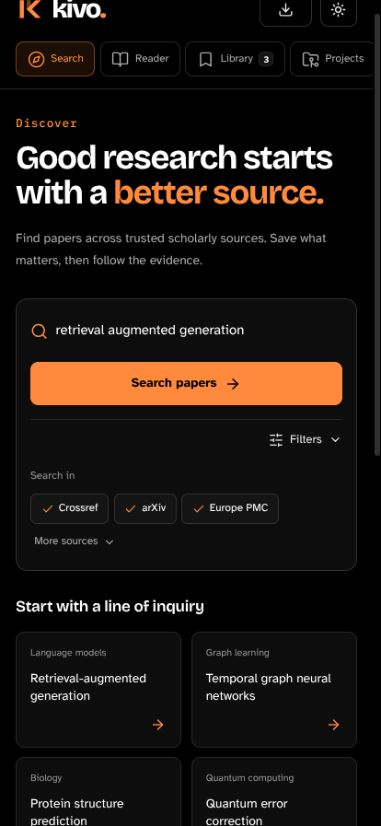
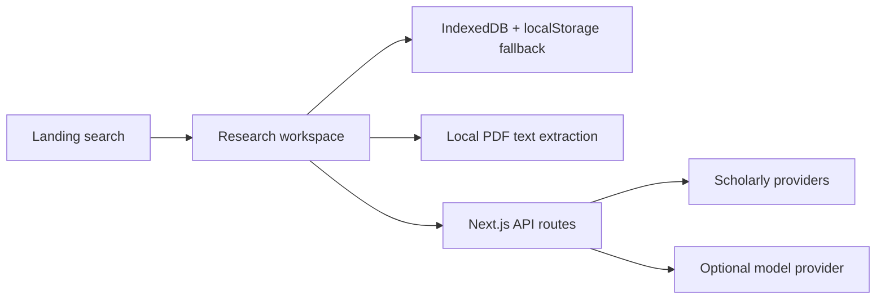

<p align="center">
  
</p>

<h1 align="center">Kivo</h1>

<p align="center"><strong>Find the paper. Keep the proof.</strong></p>
<p align="center">A local-first workspace for discovering research, capturing evidence, and building a literature review.</p>

<p align="center">
  <a href="https://kivo-nu-weld.vercel.app/">Live demo</a> ·
  <a href="#getting-started">Getting started</a> ·
  <a href="CONTRIBUTING.md">Contributing</a> ·
  <a href="https://github.com/Pratham2511/Kivo-Research-Discovery-Workspace/issues/new/choose">Report an issue</a>
</p>

<p align="center">
  <a href="https://github.com/Pratham2511/Kivo-Research-Discovery-Workspace/actions/workflows/ci.yml"></a>
  <a href="LICENSE"></a>
  
  
</p>



## Why Kivo?

Finding a paper is only the first step. Kivo keeps saved papers, exact source passages, screening decisions, and claims together so you can follow an idea back to its evidence.

Search **Crossref, arXiv, and Europe PMC** without API keys. Save useful records, attach a paper's PDF when you need its full text, and capture quotes with their page numbers. Your workspace lives in your browser; no account or database is required to get started.

## Screenshots

### Discover and organize



### Read and capture evidence



<details>
  <summary>Mobile search</summary>
  <p></p>
</details>

Screenshots show the current application using public research records. The live demo reflects the latest successful deployment.

## Features

| Workflow | What you can do |
| --- | --- |
| Discover | Search scholarly sources by topic, title, DOI, or arXiv ID. Filter by year, open access, and citations; browse up to 150 retrieved records in 20-paper pages. |
| Reader | Inspect abstracts and extract text from PDFs up to 15 MB in your browser. Capture verified verbatim passages with abstract or page anchors. |
| Library | Save papers, import BibTeX/RIS, and export matching records as BibTeX, CSV, or JSON. |
| Projects | Define a review question and protocol; screen papers with decisions, reasons, reproducibility checks, and a PRISMA-style diagram. |
| Compare | Compare up to eight papers and the evidence captured for each research field. |
| Citation map | Explore up to 20 references and 20 citing papers per center paper; export the graph as SVG. |
| Argument builder | Attach evidence to claims as support, qualification, or contradiction; export a cited Markdown outline. |
| Review | Practice recall with evidence flashcards and an SM-2 spaced-repetition schedule. |
| Alerts | Save standing queries and use **Check now** to collect newly found records. |

The default theme uses **pure black, white, and hot crimson (`#FF0055`)**, with an optional light theme, keyboard focus states, and a responsive layout. The landing page pairs DM Serif Display headings with Libre Franklin text and an unaltered flower video.

### Optional reading assistance

- Local readability estimates, a jargon heatmap, and plain-language glossary.
- Source-grounded Q&A through an optional OpenAI-compatible model provider. Returned quotations must match supplied source text; otherwise the panel abstains.
- Optional abstract rewrites with checks that detected terms and numeric values are preserved.
- Citation-context classifications using a disclosed heuristic.

These checks help keep sources traceable; they do not establish that every interpretation is correct. Connect your own provider in **Settings**, below Alerts, to enable both AI features.

### Connect your AI provider

1. Open **Settings** in the workspace and choose a provider. Google AI Studio (Gemini) is selected by default; OpenAI, Groq, and OpenRouter are also supported.
2. Paste your API key into the password field and select **Load provider models**. Choose a text model from the returned catalog, or enter its exact ID manually. Google has no preselected model; model listings do not guarantee free-tier quota. See [Google's current models](https://ai.google.dev/gemini-api/docs/models) and [API pricing and free-tier availability](https://ai.google.dev/gemini-api/docs/pricing).
3. Select **Test & save · 1 AI request** to verify one short generation on that exact model and save the working configuration. Both **Ask the paper** (abstract and extracted PDF pages) and the plain-language abstract rewrite use it immediately. **Save settings** also allows saving without a generation test.

The key is stored in **this tab's sessionStorage**, separate from research records and backups. It survives a page reload and is never written to the deployment environment or made available to other visitors. Browser session restore may retain it; use **Clear key** to remove it explicitly. Each device and browser session needs its own configuration.

**Load provider models** makes a metadata request without generating text. **Test & save** makes exactly one short generation, with no automatic retries or paper text, and can consume provider quota. It reports success only after the selected model returns text. Quota, tier, key, and unsupported-model failures remain visible. Saving settings alone makes no API request. Actual AI requests send the key and relevant source text through Kivo's server to the selected provider over HTTPS. Normal provider limits and charges apply.

Gemini uses Google's native `generateContent` API with the `x-goog-api-key` header, including for AI Studio authorization keys. Other listed providers use their OpenAI-compatible endpoints. Neither model catalogs nor connection responses include credentials.

Visitor-supplied endpoints are restricted to the listed providers, redirects are refused, credentials are never returned in responses, and answer caches are isolated by credentials and model. No database is needed, including on Vercel.

## Getting started

**Requirements:** Node.js 22+ and npm, or Bun with Node.js 22+ available for the regression tests. Internet access is needed for academic search and optional AI.

```bash
git clone https://github.com/Pratham2511/Kivo-Research-Discovery-Workspace.git
cd Kivo-Research-Discovery-Workspace
npm install
npm run dev
```

Open [http://localhost:3000](http://localhost:3000). The landing page leads to `/workspace`.

If you use Bun, `bun.lock` is the canonical dependency lockfile:

```bash
bun install --frozen-lockfile
bun run dev
```

No `.env` file is required for the default search and evidence workflows.

## Configuration

Browser AI settings require no environment changes. To configure optional scholarly integrations or an operator-managed AI fallback, copy the example and add credentials **locally**:

```bash
cp .env.example .env.local
```

| Variable | Purpose |
| --- | --- |
| `LLM_API_KEY` | Enable the optional model-backed reading features. |
| `LLM_BASE_URL` | OpenAI-compatible API base URL; defaults to `https://api.openai.com/v1`. |
| `LLM_MODEL` | Provider model name. |
| `SEMANTIC_SCHOLAR_API_KEY` | Enable Semantic Scholar keyword search and authenticated citation requests. |
| `OPENALEX_API_KEY` | Enable OpenAlex search. |
| `CORE_API_KEY` | Enable CORE search. |
| `IEEE_API_KEY` | Enable IEEE Xplore search. |
| `ACADEMIC_CONTACT_EMAIL` | Optional contact address for scholarly provider requests. |

`OPENAI_API_KEY`, `OPENAI_BASE_URL`, and `OPENAI_MODEL` are accepted aliases. A visitor's saved AI settings take precedence for their requests; environment credentials are only the operator-managed fallback. See [.env.example](.env.example) for details. Configured scholarly sources become selectable after the application reloads.

Keep credentials in server-side environment variables. Never use a `NEXT_PUBLIC_` variable for a secret, commit a real environment file, or attach a private workspace backup to a public issue.

## Data and practical limits

- **Browser storage:** IndexedDB saves the workspace, with a localStorage fallback. The app recovers the newest durable copy and warns if a save fails. Download a full backup from the sidebar before clearing browser data.
- **PDFs:** extraction happens locally; the original file is not uploaded to Kivo's extraction API or retained in the workspace. Only extracted text is saved. Scanned PDFs need OCR; extraction is capped at 500 pages and 24,000 characters per page, with a truncation notice.
- **Optional AI:** when invoked, reading APIs send the supplied abstract or relevant PDF text to your configured model provider. Browser-only PDF extraction does not make those optional AI requests offline.
- **Search coverage:** results are bounded snapshots, not a complete census of published literature. Upstream metadata, availability, and rate limits vary.
- **Access links:** a publisher/source page is distinguished from a PDF link. A PDF URL does not guarantee free access.
- **Alerts:** checks are manual; daily/weekly labels do not run a background worker while the browser is closed.
- **Accounts and sync:** there is no cloud workspace, cross-device sync, or automatic backup restore. Each browser origin has its own data.

## Architecture



Built with **Next.js 16, React 19, TypeScript, Tailwind CSS v4, Radix UI, Lucide, Zod, d3-force, and unpdf**. The Next.js application provides both the UI and API backend; a separate database server is not required.

See [Architecture](docs/ARCHITECTURE.md) for the code map and storage/search contracts.

## Verification

```bash
npm run lint
npm run typecheck
npm test
npm run build
```

The regression suite covers pagination, reversible sorting, filter validation, durable storage and fallback recovery, source URL handling, export encoding, PDF extraction, browser AI settings, request isolation, grounded PDF answers, abstract rewrites, and credential-safe provider errors. AI tests use mocked providers and consume no API quota. CI runs lint, TypeScript checks, and the tests on pushes to `main` and pull requests.

The current redesign was checked in a production build, including an eight-page public research PDF, a 5 MB synthetic PDF, filtered exports, reload persistence, and mobile search. See [Changelog](CHANGELOG.md) for release notes.

## Deployment

### Vercel

Import this repository into Vercel as a Next.js project. Add optional integration credentials in the project's environment settings and deploy the desired branch. Default search and local workspace storage require no database configuration.

### Standalone server

```bash
npm run build
PORT=3000 HOSTNAME=127.0.0.1 node .next/standalone/server.js
```

The build copies public and static assets into the standalone bundle. Bun users can run `bun run start` after building.

## Contributing and support

Bug reports, focused fixes, accessibility improvements, and scholarly-provider improvements are welcome. Read [CONTRIBUTING.md](CONTRIBUTING.md) for setup, project conventions, and review expectations.

- [Report a bug or request a feature](https://github.com/Pratham2511/Kivo-Research-Discovery-Workspace/issues/new/choose)
- [Review open pull requests](https://github.com/Pratham2511/Kivo-Research-Discovery-Workspace/pulls)
- [View release history](CHANGELOG.md)

Use reproducible examples with public or synthetic records. Remove credentials, private research notes, and identifying browser information from any shared logs or screenshots.

## License and acknowledgements

Released under the [MIT License](LICENSE). Maintained by [Pratham2511](https://github.com/Pratham2511).

Scholarly metadata comes from Crossref, arXiv, Europe PMC, Semantic Scholar, OpenAlex, CORE, and IEEE Xplore according to configured availability. Research papers and provider content remain subject to their own access and licensing terms.
